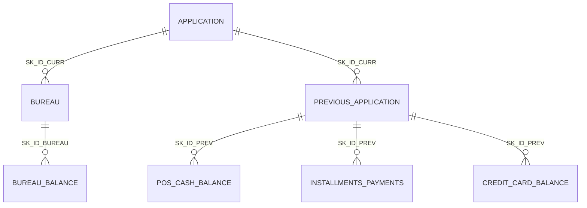

# Home Credit Default Risk — Dataset Guide

Source: [Kaggle — Home Credit Default Risk](https://www.kaggle.com/competitions/home-credit-default-risk/data)
Local copy: `data/raw/`

All row counts, missing-value rates, and coverage figures in this document were measured on the files in `data/raw/`. Column meanings come from `HomeCredit_columns_description.csv`, which ships with the dataset.

---

## 1. What the dataset is

Home Credit is a consumer lender that focuses on people with little or no credit history. The dataset describes loan applications made to Home Credit, together with everything the lender knew about each applicant at the time: the application form itself, the applicant's credit history at other lenders (from a credit bureau), and the applicant's earlier loans and repayment behaviour at Home Credit.

**Task.** For each application, predict the probability that the client will have payment difficulties. This is binary classification with a probability output.

**Target.** `TARGET` in `application_train.csv`:

| Value | Meaning | Rows | Share |
|---|---|---:|---:|
| 1 | Client had payment difficulties: a late payment of more than X days on at least one of the first Y instalments | 24,825 | 8.07% |
| 0 | All other cases | 282,686 | 91.93% |

Home Credit does not disclose X and Y. The classes are imbalanced at roughly 11 to 1.

**Evaluation metric.** Area under the ROC curve (ROC AUC) between the predicted probability and the observed target. Because AUC only depends on ranking, predictions do not need to be calibrated for the competition score, although calibration matters if the scores are used for real lending decisions.

**Submission format.** One row per `SK_ID_CURR` in `application_test.csv`, with a predicted probability in `TARGET` (see `sample_submission.csv`).

---

## 2. Files at a glance

| File | Rows | Columns | Size on disk | One row is | Primary key |
|---|---:|---:|---:|---|---|
| `application_train.csv` | 307,511 | 122 | 166 MB | One loan application, with `TARGET` | `SK_ID_CURR` |
| `application_test.csv` | 48,744 | 121 | 27 MB | One loan application, no `TARGET` | `SK_ID_CURR` |
| `bureau.csv` | 1,716,428 | 17 | 170 MB | One credit at another lender, reported by the credit bureau | `SK_ID_BUREAU` |
| `bureau_balance.csv` | 27,299,925 | 3 | 376 MB | One month of status for one bureau credit | (`SK_ID_BUREAU`, `MONTHS_BALANCE`) |
| `previous_application.csv` | 1,670,214 | 37 | 405 MB | One earlier application to Home Credit | `SK_ID_PREV` |
| `POS_CASH_balance.csv` | 10,001,358 | 8 | 393 MB | One month of a previous POS or cash loan | (`SK_ID_PREV`, `MONTHS_BALANCE`) |
| `installments_payments.csv` | 13,605,401 | 8 | 723 MB | One payment made, or one instalment missed | none (see section 9) |
| `credit_card_balance.csv` | 3,840,312 | 23 | 425 MB | One month of a previous credit card | (`SK_ID_PREV`, `MONTHS_BALANCE`) |
| `HomeCredit_columns_description.csv` | 219 | 4 | 37 KB | One column definition | n/a |
| `sample_submission.csv` | 48,744 | 2 | 0.5 MB | One test application | `SK_ID_CURR` |

The data tables total about 2.7 GB as CSV. Loaded into pandas with default dtypes, the largest tables each take 700–900 MB of memory, so they are best loaded one at a time and aggregated before joining.

---

## 3. How the tables relate

There are three levels. The application tables are the spine. Two independent branches hang off them: credit history at other lenders (bureau) and history at Home Credit itself (previous applications).

| Key | Identifies | Appears in |
|---|---|---|
| `SK_ID_CURR` | The current loan application (the unit of prediction) | Every table except `bureau_balance` |
| `SK_ID_BUREAU` | One credit at another lender | `bureau`, `bureau_balance` |
| `SK_ID_PREV` | One earlier application or loan at Home Credit | `previous_application`, `POS_CASH_balance`, `installments_payments`, `credit_card_balance` |

Every relationship is one-to-many going downwards, so the child tables must be aggregated to one row per `SK_ID_CURR` before they can be joined to the application table. The three Home Credit behaviour tables carry `SK_ID_CURR` as well as `SK_ID_PREV`, so they can be aggregated straight to the applicant or first to the previous loan.

### How much of the spine each table covers

Not every applicant has history. An applicant missing from a child table has no such history, which is itself informative.

| Child table | Train applicants with at least one row | Test applicants with at least one row | Rows per applicant (mean / median / max) |
|---|---:|---:|---|
| `bureau` | 85.7% | 86.8% | 5.6 / 4 / 116 |
| `previous_application` | 94.7% | 98.1% | 4.9 / 4 / 77 |
| `POS_CASH_balance` | 94.1% | 98.1% | 29.7 / 22 / 295 |
| `installments_payments` | 94.8% | 98.4% | 40.1 / 25 / 372 |
| `credit_card_balance` | 28.3% | 34.2% | 37.1 / 22 / 192 |

Train and test share no `SK_ID_CURR` values. Every `SK_ID_CURR` in a child table exists in either train or test.

### Referential gaps to be aware of

- Only 45.1% of the credits in `bureau` have any monthly history in `bureau_balance`.
- 43,041 `SK_ID_BUREAU` values in `bureau_balance` do not exist in `bureau`. These rows cannot be linked to an applicant.
- Some `SK_ID_PREV` values in the behaviour tables are missing from `previous_application`: 37,422 in `POS_CASH_balance`, 38,847 in `installments_payments`, and 11,372 in `credit_card_balance`. They still carry `SK_ID_CURR`, so they can be aggregated to the applicant directly.

---

## 4. Conventions that apply across tables

**Time is relative, not absolute.** There are no calendar dates. Every `DAYS_*` column counts days relative to the current application, and negative means before it. `DAYS_BIRTH = -15750` means the client was born 15,750 days before applying (about 43 years old). `MONTHS_BALANCE` works the same way in months: `-1` is the most recent monthly snapshot before the application. History goes back at most 2,922 days (8 years) or 96 months.

**`365243` is a placeholder, not a number of days.** It equals about 1,000 years and stands for "not applicable" or "no end date". Replace it with a missing value before computing anything.

| Table | Column | Rows with 365243 |
|---|---|---:|
| `application_train` | `DAYS_EMPLOYED` | 55,374 (18.0%) |
| `application_test` | `DAYS_EMPLOYED` | 9,274 (19.0%) |
| `previous_application` | `DAYS_FIRST_DRAWING` | 934,444 |
| `previous_application` | `DAYS_FIRST_DUE` | 40,645 |
| `previous_application` | `DAYS_LAST_DUE_1ST_VERSION` | 93,864 |
| `previous_application` | `DAYS_LAST_DUE` | 211,221 |
| `previous_application` | `DAYS_TERMINATION` | 225,913 |

In the application tables the `DAYS_EMPLOYED` placeholder falls on exactly the rows where `ORGANIZATION_TYPE = "XNA"` (55,374 in train, 9,274 in test). All but 22 of those train rows are pensioners. It marks clients with no current employer.

**`XNA` and `XAP` are hidden missing values.** Several categorical columns use the strings `XNA` ("not available") and `XAP` ("not applicable") instead of leaving the cell empty, so a standard null check reports these columns as complete when they are not.

**Column name prefixes.**

| Prefix | Meaning |
|---|---|
| `SK_ID_` | Surrogate key |
| `AMT_` | Monetary amount. The currency is not stated |
| `CNT_` | Count |
| `DAYS_` / `MONTHS_` | Time relative to the current application |
| `FLAG_` / `NFLAG_` | Binary indicator (`Y`/`N` as text, or `1`/`0`) |
| `NAME_` / `CODE_` | Categorical |
| `RATE_` | Normalised rate |
| `SK_DPD` | Days past due |

**Anonymisation.** Keys are hashed, currency is recoded, and many numeric fields (the `EXT_SOURCE_*` scores, the housing block, region population) are normalised to a 0–1 range, so their raw units are not recoverable.

---

## 5. `application_train.csv` and `application_test.csv`

The main table. One row per loan application, 121 feature columns plus `TARGET` in train. Column types in train: 65 float, 41 integer, 16 text. 67 of the columns have missing values, and 41 are more than half empty (almost all of them in the housing block).

### 5.1 Column groups

| Group | Columns | Count | Notes |
|---|---|---:|---|
| Identifier and target | `SK_ID_CURR`, `TARGET` | 2 | `TARGET` is absent from test |
| Loan | `NAME_CONTRACT_TYPE`, `AMT_CREDIT`, `AMT_ANNUITY`, `AMT_GOODS_PRICE` | 4 | Loan amount, periodic payment, and price of the goods financed |
| Demographics | `CODE_GENDER`, `DAYS_BIRTH`, `CNT_CHILDREN`, `CNT_FAM_MEMBERS`, `NAME_FAMILY_STATUS`, `NAME_EDUCATION_TYPE`, `NAME_TYPE_SUITE` | 7 | `NAME_TYPE_SUITE` is who accompanied the client when applying |
| Income and employment | `AMT_INCOME_TOTAL`, `NAME_INCOME_TYPE`, `OCCUPATION_TYPE`, `ORGANIZATION_TYPE`, `DAYS_EMPLOYED` | 5 | `OCCUPATION_TYPE` is 31% missing. `ORGANIZATION_TYPE` has 58 levels |
| Assets and housing situation | `FLAG_OWN_CAR`, `OWN_CAR_AGE`, `FLAG_OWN_REALTY`, `NAME_HOUSING_TYPE` | 4 | `OWN_CAR_AGE` is 66% missing: it is empty for every client without a car |
| Region | `REGION_POPULATION_RELATIVE`, `REGION_RATING_CLIENT`, `REGION_RATING_CLIENT_W_CITY` | 3 | Ratings are Home Credit's own, on a 1–3 scale |
| Address mismatch flags | `REG_REGION_NOT_LIVE_REGION`, `REG_REGION_NOT_WORK_REGION`, `LIVE_REGION_NOT_WORK_REGION`, `REG_CITY_NOT_LIVE_CITY`, `REG_CITY_NOT_WORK_CITY`, `LIVE_CITY_NOT_WORK_CITY` | 6 | 1 when the permanent, contact, and work addresses disagree |
| Contact flags | `FLAG_MOBIL`, `FLAG_EMP_PHONE`, `FLAG_WORK_PHONE`, `FLAG_CONT_MOBILE`, `FLAG_PHONE`, `FLAG_EMAIL` | 6 | Whether each contact detail was provided or reachable |
| Document and registration timing | `DAYS_REGISTRATION`, `DAYS_ID_PUBLISH`, `DAYS_LAST_PHONE_CHANGE` | 3 | Days since the client last changed registration, ID document, or phone |
| Application timing | `WEEKDAY_APPR_PROCESS_START`, `HOUR_APPR_PROCESS_START` | 2 | When the application was started |
| External scores | `EXT_SOURCE_1`, `EXT_SOURCE_2`, `EXT_SOURCE_3` | 3 | Normalised scores from outside data sources. The strongest single predictors |
| Housing block | 14 building measures × 3 suffixes (`_AVG`, `_MODE`, `_MEDI`), plus `TOTALAREA_MODE`, `FONDKAPREMONT_MODE`, `HOUSETYPE_MODE`, `WALLSMATERIAL_MODE`, `EMERGENCYSTATE_MODE` | 47 | Normalised facts about the client's building. 47–70% missing |
| Social circle | `OBS_30_CNT_SOCIAL_CIRCLE`, `DEF_30_CNT_SOCIAL_CIRCLE`, `OBS_60_CNT_SOCIAL_CIRCLE`, `DEF_60_CNT_SOCIAL_CIRCLE` | 4 | How many people around the client were observed, and how many defaulted, at 30 and 60 days past due |
| Documents provided | `FLAG_DOCUMENT_2` … `FLAG_DOCUMENT_21` | 20 | Which documents were supplied. What each document is has not been disclosed |
| Bureau enquiries | `AMT_REQ_CREDIT_BUREAU_HOUR`, `_DAY`, `_WEEK`, `_MON`, `_QRT`, `_YEAR` | 6 | Number of credit bureau enquiries in non-overlapping windows before the application. 13.5% missing |

The 14 building measures in the housing block are: `APARTMENTS`, `BASEMENTAREA`, `YEARS_BEGINEXPLUATATION`, `YEARS_BUILD`, `COMMONAREA`, `ELEVATORS`, `ENTRANCES`, `FLOORSMAX`, `FLOORSMIN`, `LANDAREA`, `LIVINGAPARTMENTS`, `LIVINGAREA`, `NONLIVINGAPARTMENTS`, `NONLIVINGAREA`. The three suffixes are the mean, mode, and median of the same measure, so the three versions of each are close to duplicates.

### 5.2 What the applicants look like (train)

| Attribute | Distribution |
|---|---|
| Contract type | Cash loans 90.5%, revolving loans 9.5% |
| Gender | Female 65.8%, male 34.2%, `XNA` 4 rows |
| Age | 20.5 to 69.1 years, median 43.2 |
| Owns a car / owns property | 34.0% / 69.4% |
| Income type | Working 51.6%, commercial associate 23.3%, pensioner 18.0%, state servant 7.1%, four other categories 55 rows in total |
| Education | Secondary 71.0%, higher 24.3%, incomplete higher 3.3%, lower secondary 1.2%, academic degree 164 rows |
| Family status | Married 63.9%, single 14.8%, civil marriage 9.7%, separated 6.4%, widow 5.2% |
| Housing | House or apartment 88.7%, with parents 4.8%, municipal apartment 3.6% |

| Amount | Minimum | Median | Maximum |
|---|---:|---:|---:|
| `AMT_INCOME_TOTAL` | 25,650 | 147,150 | 117,000,000 |
| `AMT_CREDIT` | 45,000 | 513,531 | 4,050,000 |
| `AMT_ANNUITY` | 1,616 | 24,903 | 258,026 |
| `AMT_GOODS_PRICE` | 40,500 | 450,000 | 4,050,000 |

### 5.3 Relationship with the target

Linear correlation with `TARGET` is weak for every individual column, which is typical for credit data. The largest values:

| Column | Correlation with `TARGET` | Reading |
|---|---:|---|
| `EXT_SOURCE_3` | −0.179 | Higher external score, lower default |
| `EXT_SOURCE_2` | −0.160 | Same |
| `EXT_SOURCE_1` | −0.155 | Same |
| `DAYS_BIRTH` | +0.078 | Younger clients default more (the column is negative, so a larger value means younger) |
| `REGION_RATING_CLIENT_W_CITY` | +0.061 | Worse region rating, higher default |
| `DAYS_LAST_PHONE_CHANGE` | +0.055 | A recent phone change goes with higher default |

Default rate by group:

| Group | Default rate | Rows |
|---|---:|---:|
| Male | 10.1% | 105,059 |
| Female | 7.0% | 202,448 |
| Cash loans | 8.3% | 278,232 |
| Revolving loans | 5.5% | 29,279 |

### 5.4 Missing values

| Column or group | Missing in train | Missing in test |
|---|---:|---:|
| Housing block | 47–70% | 46–69% |
| `OWN_CAR_AGE` | 66.0% | 66.3% |
| `EXT_SOURCE_1` | 56.4% | 42.1% |
| `OCCUPATION_TYPE` | 31.4% | 32.0% |
| `EXT_SOURCE_3` | 19.8% | 17.8% |
| `AMT_REQ_CREDIT_BUREAU_*` | 13.5% | 12.4% |
| `NAME_TYPE_SUITE` | 0.4% | 1.9% |
| `OBS_*` / `DEF_*_SOCIAL_CIRCLE` | 0.3% | 0.1% |
| `EXT_SOURCE_2` | 0.2% | 0.02% |
| `AMT_GOODS_PRICE` | 0.09% | 0% |
| `AMT_ANNUITY` | 12 rows | 0.05% |

### 5.5 Quirks and differences between train and test

- `DAYS_EMPLOYED = 365243` for 18% of rows (see section 4).
- `AMT_INCOME_TOTAL` has a single extreme value of 117 million in train. The test maximum is 4.4 million.
- `CODE_GENDER = "XNA"` (4 rows) and `NAME_FAMILY_STATUS = "Unknown"` (2 rows) occur only in train. `NAME_INCOME_TYPE = "Maternity leave"` (5 rows) occurs only in train.
- `REGION_RATING_CLIENT_W_CITY` contains a value of `-1` in test, outside the documented 1–3 scale.
- Revolving loans are 9.5% of train but only 0.9% of test.
- Eleven document flags are zero for every test row: `FLAG_DOCUMENT_2`, `10`, `12`, `13`, `14`, `15`, `16`, `17`, `19`, `20`, `21`.
- `OBS_30_CNT_SOCIAL_CIRCLE` reaches 348 and `AMT_REQ_CREDIT_BUREAU_QRT` reaches 261 in train, far beyond the rest of their distributions.
- The description file defines both `FLAG_WORK_PHONE` and `FLAG_PHONE` as "home phone". One of the two definitions is presumably a typo in the source.

---

## 6. `bureau.csv`

Credits the applicant holds or held at **other** financial institutions, as reported to the credit bureau. One row per credit. 305,811 applicants appear here.

| Column | Meaning | Missing |
|---|---|---:|
| `SK_ID_CURR` | Applicant | 0% |
| `SK_ID_BUREAU` | The bureau credit (unique) | 0% |
| `CREDIT_ACTIVE` | Status: Closed 62.9%, Active 36.7%, Sold 6,527 rows, Bad debt 21 rows | 0% |
| `CREDIT_CURRENCY` | Recoded currency. 99.9% are `currency 1` | 0% |
| `DAYS_CREDIT` | Days before the current application that this credit was applied for (−2,922 to 0) | 0% |
| `CREDIT_DAY_OVERDUE` | Days past due on this credit at the time of the current application | 0% |
| `DAYS_CREDIT_ENDDATE` | Remaining duration in days at application time. Negative if it has already ended | 6.2% |
| `DAYS_ENDDATE_FACT` | Days since the credit actually ended. Closed credits only | 36.9% |
| `AMT_CREDIT_MAX_OVERDUE` | Largest amount ever overdue on this credit | 65.5% |
| `CNT_CREDIT_PROLONG` | Number of times the credit was prolonged | 0% |
| `AMT_CREDIT_SUM` | Credit amount | 13 rows |
| `AMT_CREDIT_SUM_DEBT` | Current outstanding debt | 15.0% |
| `AMT_CREDIT_SUM_LIMIT` | Current credit card limit | 34.5% |
| `AMT_CREDIT_SUM_OVERDUE` | Current amount overdue | 0% |
| `CREDIT_TYPE` | 15 types. Consumer credit 72.9%, credit card 23.4%, car loan 1.6%, mortgage 1.1%, microloan 0.7% | 0% |
| `DAYS_CREDIT_UPDATE` | Days before the application that the bureau last updated this record | 0% |
| `AMT_ANNUITY` | Annuity of the bureau credit | 71.5% |

**Quirks.** `DAYS_CREDIT_ENDDATE`, `DAYS_ENDDATE_FACT`, and `DAYS_CREDIT_UPDATE` reach about −42,000 days (roughly 115 years), which cannot be real. `DAYS_CREDIT_UPDATE` has positive values up to 372, meaning an update dated after the application. `AMT_CREDIT_SUM_DEBT` and `AMT_CREDIT_SUM_LIMIT` contain negative values. The description file calls the key `SK_BUREAU_ID`, but the actual column is `SK_ID_BUREAU`.

---

## 7. `bureau_balance.csv`

Month-by-month status of the bureau credits. One row per credit per month. Covers 817,395 credits with a mean of 33 months each (maximum 97). No missing values.

| Column | Meaning |
|---|---|
| `SK_ID_BUREAU` | Joins to `bureau` |
| `MONTHS_BALANCE` | Month relative to the application, from −96 to 0 |
| `STATUS` | Status of the credit in that month (see below) |

| `STATUS` | Meaning | Rows | Share |
|---|---|---:|---:|
| `C` | Closed | 13,646,993 | 50.0% |
| `0` | No days past due | 7,499,507 | 27.5% |
| `X` | Status unknown | 5,810,482 | 21.3% |
| `1` | 1–30 days past due | 242,347 | 0.89% |
| `2` | 31–60 days past due | 23,419 | 0.09% |
| `3` | 61–90 days past due | 8,924 | 0.03% |
| `4` | 91–120 days past due | 5,847 | 0.02% |
| `5` | More than 120 days past due, sold, or written off | 62,406 | 0.23% |

The description file only spells out `C`, `X`, `0`, `1`, `2`, and `5`. Statuses `3` and `4` follow the same 30-day bands.

This table has no `SK_ID_CURR`. To reach the applicant, aggregate to `SK_ID_BUREAU`, join to `bureau`, then aggregate again to `SK_ID_CURR`.

---

## 8. `previous_application.csv`

Every earlier application the client made to Home Credit, whether or not it became a loan. One row per application. 338,857 applicants appear here. Column types: 16 text, 15 float, 6 integer.

| Group | Columns | Notes |
|---|---|---|
| Keys | `SK_ID_PREV`, `SK_ID_CURR` | `SK_ID_PREV` is unique |
| Product | `NAME_CONTRACT_TYPE`, `NAME_PORTFOLIO`, `NAME_PRODUCT_TYPE`, `PRODUCT_COMBINATION`, `NAME_YIELD_GROUP` | Contract type: cash 44.8%, consumer 43.7%, revolving 11.6% |
| Amounts | `AMT_APPLICATION`, `AMT_CREDIT`, `AMT_ANNUITY`, `AMT_DOWN_PAYMENT`, `AMT_GOODS_PRICE` | `AMT_APPLICATION` is what the client asked for and `AMT_CREDIT` is what was finally granted |
| Rates and term | `RATE_DOWN_PAYMENT`, `RATE_INTEREST_PRIMARY`, `RATE_INTEREST_PRIVILEGED`, `CNT_PAYMENT` | The two interest rate columns are 99.6% missing |
| Outcome | `NAME_CONTRACT_STATUS`, `CODE_REJECT_REASON`, `DAYS_DECISION` | Approved 62.1%, canceled 18.9%, refused 17.4%, unused offer 1.6% |
| Purpose and goods | `NAME_CASH_LOAN_PURPOSE`, `NAME_GOODS_CATEGORY` | Dominated by `XAP` and `XNA` |
| Client and channel | `NAME_CLIENT_TYPE`, `NAME_TYPE_SUITE`, `CHANNEL_TYPE`, `NAME_SELLER_INDUSTRY`, `SELLERPLACE_AREA`, `NAME_PAYMENT_TYPE` | Client type: repeater 73.7%, new 18.0%, refreshed 8.1% |
| Application timing | `WEEKDAY_APPR_PROCESS_START`, `HOUR_APPR_PROCESS_START`, `FLAG_LAST_APPL_PER_CONTRACT`, `NFLAG_LAST_APPL_IN_DAY` | The two flags mark duplicate applications for the same contract or day |
| Loan lifecycle | `DAYS_FIRST_DRAWING`, `DAYS_FIRST_DUE`, `DAYS_LAST_DUE_1ST_VERSION`, `DAYS_LAST_DUE`, `DAYS_TERMINATION`, `NFLAG_INSURED_ON_APPROVAL` | 40.3% missing, and heavily affected by the `365243` placeholder |

**Missing values.** `RATE_INTEREST_PRIMARY` and `RATE_INTEREST_PRIVILEGED` 99.6%, `AMT_DOWN_PAYMENT` and `RATE_DOWN_PAYMENT` 53.6%, `NAME_TYPE_SUITE` 49.1%, the six lifecycle columns 40.3%, `AMT_GOODS_PRICE` 23.1%, `AMT_ANNUITY` and `CNT_PAYMENT` 22.3%.

**Hidden missing values.** These columns are nominally complete but are mostly placeholders:

| Column | Placeholder share |
|---|---:|
| `NAME_CASH_LOAN_PURPOSE` | 95.8% (`XAP` 55.2%, `XNA` 40.6%) |
| `NAME_PRODUCT_TYPE` | 63.7% `XNA` |
| `NAME_GOODS_CATEGORY` | 56.9% `XNA` |
| `NAME_SELLER_INDUSTRY` | 51.2% `XNA` |
| `NAME_PAYMENT_TYPE` | 37.6% `XNA` |
| `NAME_YIELD_GROUP` | 31.0% `XNA` |
| `NAME_PORTFOLIO` | 22.3% `XNA` |

In `CODE_REJECT_REASON`, `XAP` (81.0%) means the application was not rejected, so it is a real category rather than a missing value.

**Quirks.** `SELLERPLACE_AREA` uses `-1` as a placeholder. `AMT_DOWN_PAYMENT` and `RATE_DOWN_PAYMENT` have slightly negative minimums. The description file lists a column `NFLAG_MICRO_CASH` that does not exist in the data, which is why it describes 38 columns for a 37-column table.

---

## 9. `installments_payments.csv`

Repayment history for previous Home Credit loans. Each row is either a payment the client made or an instalment the client missed. Covers 997,752 previous loans and 339,587 applicants. All columns are numeric.

| Column | Meaning | Missing |
|---|---|---:|
| `SK_ID_PREV`, `SK_ID_CURR` | Previous loan and applicant | 0% |
| `NUM_INSTALMENT_VERSION` | Version of the payment calendar. `0` means credit card. A change in version means the schedule was changed | 0% |
| `NUM_INSTALMENT_NUMBER` | Which instalment this row refers to | 0% |
| `DAYS_INSTALMENT` | When the instalment was due | 0% |
| `DAYS_ENTRY_PAYMENT` | When it was actually paid | 0.02% |
| `AMT_INSTALMENT` | Amount due | 0% |
| `AMT_PAYMENT` | Amount actually paid | 0.02% |

The two columns with missing values are always missing together (2,905 rows). These are the instalments with no payment recorded.

The table has no natural primary key, because one instalment can be settled by several partial payments and each appears as its own row. This matters for two derived features that most models rely on:

- **Lateness**: `DAYS_ENTRY_PAYMENT − DAYS_INSTALMENT`. Positive means paid late. 8.4% of rows are late.
- **Shortfall**: `AMT_INSTALMENT − AMT_PAYMENT`. 9.5% of rows show a payment below the amount due. Some of these are partial payments that add up to the full amount, so sum `AMT_PAYMENT` per instalment before treating a row as underpaid.

---

## 10. `POS_CASH_balance.csv`

Monthly snapshots of previous point-of-sale and cash loans at Home Credit. One row per loan per month. Covers 936,325 previous loans with a mean of 10.7 months each.

| Column | Meaning | Missing |
|---|---|---:|
| `SK_ID_PREV`, `SK_ID_CURR` | Previous loan and applicant | 0% |
| `MONTHS_BALANCE` | Month relative to the application, from −96 to −1 | 0% |
| `CNT_INSTALMENT` | Term of the loan. Can change over time | 0.26% |
| `CNT_INSTALMENT_FUTURE` | Instalments left to pay | 0.26% |
| `NAME_CONTRACT_STATUS` | Active 91.5%, Completed 7.4%, Signed 0.9%, plus rare states such as Demand, Returned to the store, and Amortized debt | 0% |
| `SK_DPD` | Days past due in that month | 0% |
| `SK_DPD_DEF` | Days past due with tolerance, ignoring small debts | 0% |

`SK_DPD` is zero in the typical month but reaches 4,231 days, so it is heavily skewed.

---

## 11. `credit_card_balance.csv`

Monthly snapshots of previous Home Credit credit cards. One row per card per month. Covers 104,307 cards and 103,558 applicants, which makes it the narrowest table: fewer than a third of applicants have any rows.

| Group | Columns | Missing |
|---|---|---:|
| Keys and time | `SK_ID_PREV`, `SK_ID_CURR`, `MONTHS_BALANCE` | 0% |
| Balance and limit | `AMT_BALANCE`, `AMT_CREDIT_LIMIT_ACTUAL` | 0% |
| Drawings, amounts | `AMT_DRAWINGS_CURRENT` (total), `AMT_DRAWINGS_ATM_CURRENT`, `AMT_DRAWINGS_POS_CURRENT`, `AMT_DRAWINGS_OTHER_CURRENT` | Total 0%, breakdown 19.5% |
| Drawings, counts | `CNT_DRAWINGS_CURRENT` (total), `CNT_DRAWINGS_ATM_CURRENT`, `CNT_DRAWINGS_POS_CURRENT`, `CNT_DRAWINGS_OTHER_CURRENT` | Total 0%, breakdown 19.5% |
| Payments | `AMT_INST_MIN_REGULARITY` (minimum instalment), `AMT_PAYMENT_CURRENT`, `AMT_PAYMENT_TOTAL_CURRENT` | 8.0%, 20.0%, 0% |
| Receivables | `AMT_RECEIVABLE_PRINCIPAL`, `AMT_RECIVABLE`, `AMT_TOTAL_RECEIVABLE` | 0% |
| Instalments paid | `CNT_INSTALMENT_MATURE_CUM` | 8.0% |
| Status and delinquency | `NAME_CONTRACT_STATUS`, `SK_DPD`, `SK_DPD_DEF` | 0% |

`NAME_CONTRACT_STATUS` is Active for 96.3% of rows and Completed for 3.4%.

**Quirks.** `AMT_RECIVABLE` is misspelled in the source and must be referenced that way. `AMT_BALANCE` and the three receivable columns go negative (down to about −420,000), which indicates an overpaid card. `AMT_DRAWINGS_ATM_CURRENT` and `AMT_DRAWINGS_CURRENT` have small negative minimums. A common derived feature is utilisation, `AMT_BALANCE / AMT_CREDIT_LIMIT_ACTUAL`, which needs a guard because the limit can be zero.

---

## 12. `HomeCredit_columns_description.csv`

The official data dictionary: 219 rows with the columns `Table`, `Row` (the column name), `Description`, and `Special` (notes such as "normalized", "hashed", or "time only relative to the application"). It is encoded as Latin-1, so reading it as UTF-8 fails.

Known discrepancies between the dictionary and the data:

| Dictionary says | Data has |
|---|---|
| `SK_BUREAU_ID` | `SK_ID_BUREAU` |
| `NFLAG_MICRO_CASH` in `previous_application` | No such column |
| `SK_ID_PREV ` with a trailing space | `SK_ID_PREV` |
| `MONTHS_BALANCE = -1` is the freshest month | `bureau_balance` also has month `0` |
| `STATUS` values `C`, `X`, `0`, `1`, `2`, `5` | Also `3` and `4` |

---

## 13. Implications for modelling

1. **Aggregate before joining.** The model needs one row per `SK_ID_CURR`. Each child table has to be summarised (counts, sums, means, minimums, maximums, most recent values) to that level. `bureau_balance` needs two rounds of aggregation.
2. **Clean placeholders first.** Convert `365243` to missing in the `DAYS_*` columns, and decide how to treat `XNA` and `XAP` per column, before computing any aggregate.
3. **Missing is informative.** An applicant with no bureau rows or no previous applications is a different kind of client from one with a clean history. Keep that distinction, for example with a "has history" flag or by leaving the aggregates empty for a model that handles missing values natively.
4. **Handle the class imbalance.** With 8% positives, use stratified cross-validation and evaluate with AUC rather than accuracy.
5. **Expect redundancy.** The housing block holds three near-identical versions of 14 measures and is about half empty. `AMT_CREDIT` and `AMT_GOODS_PRICE` are closely related, as are the two region ratings and the 30-day and 60-day social circle counts.
6. **Ratios carry signal.** The most useful engineered features on this dataset tend to combine columns: credit to income, annuity to income, annuity to credit (an implied term), employment length to age, and the mean or product of the three `EXT_SOURCE` scores.
7. **Watch train and test differences.** Revolving loans are far rarer in test, several document flags are constant in test, and a few categories exist only in train. Validate with that in mind.
8. **Time is relative only.** The history tables are dated relative to the application and their monthly snapshots end at or before it. The one exception found is `DAYS_CREDIT_UPDATE` in `bureau`, which has some positive values. There is no calendar date, which means a time-based train and validation split is not possible.
9. **Sensitive attributes.** `CODE_GENDER`, `DAYS_BIRTH`, and `NAME_FAMILY_STATUS` are predictive, and they are also protected characteristics under fair lending rules in many jurisdictions. That does not matter for the competition, but it does for any deployed credit model.
